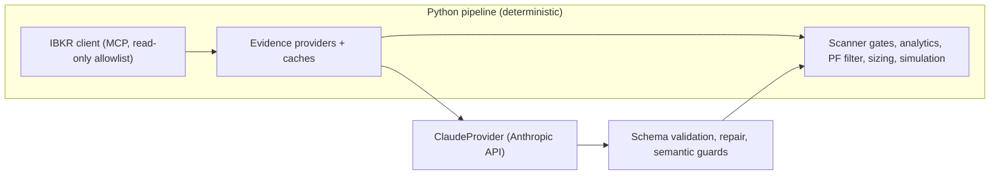
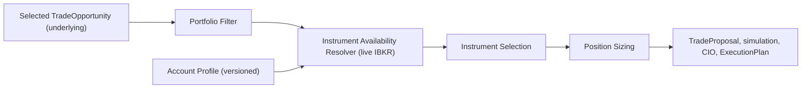

# Stage 5.0 — Agentic Portfolio on IBKR and Claude

## 1. Document status

| Field | Value |
| --- | --- |
| Role | Design proposal for the Stage 5.0 major release. Review before any code is written |
| Status | APPROVED by Paolo 2026-11-06 — revision 4; implementation in progress (§8) |
| Date | 2026-11-04 |
| Revision 1 | Live IBKR portfolio: no file import of any kind; versioned snapshots on every broker-side change; change-driven, minimal re-computation (§5A). Supersedes the original draft where they differ |
| Revision 2 | No persisted instrument catalog: tradable instruments are discovered live from IBKR per stock and filtered by the account profile (trading permissions, IBKR entity and country, flow type). New Account Profile and Instrument Availability components (§5B). Instrument-reference, proxy and symbol-mapping modules retired |
| Revision 3 | TEMPORARY simulated portfolio for tests and E2E while the Fineco → IBKR transfer of the US stocks is pending (§5C). Architecture approved |
| Revision 4 | Evidence source strategy approved by Paolo 2026-11-06 after a coverage check on all 26 Fineco holdings: IBKR primary, IB Gateway news for daily headlines, Yahoo kept as a declared secondary source for analysts and fundamentals; ISIN-keyed contract resolution (§5D). Closes decision 1 (G1) and revises G3 |
| Source baseline | `lupoleo/agentic_portfolio_stage4_0` at `afca47d` (AI-8C.2-R5 merged), `STAGE_4_0_ARCHITECTURE.md` |
| Project form | New standalone repository and folder (`agentic_portfolio_stage5_0`), not a branch of 4.0 |
| Product | Aleph Innovation product portfolio |

### 1.1 What changes, what does not

Stage 5.0 keeps the **logical and functional architecture of 4.0 unchanged**:
the same two upstream sources, the same gate sequence, the same evidence,
research, company assessment, directional scoring, operator selection,
Portfolio Filter, sizing, simulation, CIO decision, manual execution and
shadow ledger. The invariants of 4.0 §3 are carried over verbatim.

Only three things change, all at provider boundaries:

1. **Broker and portfolio source:** offline Fineco Excel export → **live**
   IBKR account. Stage 5.0 loads no Excel, CSV or other file for portfolio,
   account, cash or liquidity data. Every such value is read from IBKR, and
   every change made on the IBKR side is detected, persisted as a new
   versioned snapshot and propagated to only the tasks it affects (§5A).
   Instruments are not loaded or persisted either: for each stock, IBKR is
   asked live which instruments exist (stock, CFD, options, warrants, futures,
   ...) and the list is filtered by what this account is permitted to trade
   (§5B).
2. **External data and news:** Yahoo Finance (news, history, fundamentals,
   analyst targets), EODHD (universe) and ECB (FX) → IBKR data wherever IBKR
   offers it. Where IBKR has no equivalent (daily headlines outside IB
   Gateway, analyst ratings, financial statements) Yahoo stays as a declared
   secondary source (§5D). Gaps are listed in §7.
3. **LLM:** local Ollama `qwen3:8b` → Claude through the Anthropic API.

---

## 2. Facts verified on the live IBKR connector (read-only, 2026-11-04)

These checks were made with read-only tools only. No order, alert, watchlist
or screener was created.

| Check | Result |
| --- | --- |
| Connector version | 1.2.1 (2026-10-27). Release 1.1.5 allows connecting "from any MCP client", so a Python program can call it directly, not only Claude |
| Account base currency | EUR |
| Account size | Net liquidation ≈ EUR 6,015; cash ≈ EUR 3,927; leverage 0.35 |
| Positions | 1 position: `DHR` (Danaher), 10 shares, conid 6442, USD |
| News tool | **None.** The connector exposes no general news feed or headline search |
| Earnings insights for DHR | Available: previews and recaps (2026-07-21, 2026-10-18, 2026-10-21) with titles, guidance, KPIs and citations |
| Earnings insights for ENEL (BVME, conid 29816333) | **Empty.** Coverage for Italian/European names is missing or thin |
| Company themes for DHR | Available: themes with ranked peers and evidence text |
| Contract search | Works across venues (BVME, NYSE, MEXI, ...), returns conids and, per underlying, the available security types (ENEL: STK, OPT, FUT, WAR, IOPT, BAG) |
| Cash by currency | `get_account_balances`: EUR 3,000.03, USD 1,040.61 (base EUR) |
| Flow type | `get_flow_type` = `REVIEW_AND_APPROVE`: this connector session cannot place live orders, only order instructions that the operator approves |
| Screener regions | US stocks (default), US equity ETFs, US fixed-income ETFs, Europe stocks, Hong Kong stocks |
| Trading permissions and account country | **Not exposed** by any connector tool (G11) |

Two consequences shape the whole design:

- "News from IBKR" through the connector means **earnings insights, company
  themes/connections and investment topics**, not a headline feed (§5.3).
- The live portfolio is tiny compared with the 4.0 Fineco book (1 position,
  ~EUR 6k vs 41 positions, ~EUR 305k). Portfolio Filter and sizing parameters
  must be re-based (§7, G7).

---

## 3. Architectural invariants (carried over from 4.0 §3)

All 4.0 invariants stay. Stage 5.0 restates them for the new providers:

- **Real vs proposed state.** IBKR is the source of truth for positions, cash
  and account state. `REAL`, `SIMULATED`, `PROPOSED` remain separate.
- **Live state, immutable records.** The IBKR account is read live, but every
  read that differs from the last one becomes a new immutable, fingerprinted
  `PortfolioSnapshot` / `AccountState` version. Every run and result still
  binds to an explicit snapshot ID (the 4.0 "no latest lookup" rule); the
  system never mutates an old snapshot when the account changes.
- **No file inputs for real state.** No portfolio, account or liquidity value
  may come from a file. Files under `config/` hold policies and reviewed
  reference data only.
- **Python owns deterministic finance.** Prices, volumes, FX, liquidity,
  technical indicators, risk, sizing and simulation are computed in Python from
  IBKR data fetched by Python, never by Claude through a tool call.
- **Unknown is safer than fabricated certainty.** An empty IBKR response
  (for example no earnings insight for ENEL) is `UNAVAILABLE` evidence, never a
  pass and never "no news".
- **Listing identity is immutable.** The listing key stays
  `(exchange, provider_symbol)`; the IBKR `conid` becomes the market-data
  instrument identity (replacing the Yahoo symbol).
- **Human control is mandatory and the system never trades.** This is now
  enforced technically as well (§4.3): the IBKR connector has write tools
  (orders, order instructions, alerts, watchlists, saved screeners and, since
  1.2.1, "autonomous trading"). Stage 5.0 uses a **read-only allowlist** and
  the counters `broker_orders_submitted = 0`, `portfolio_mutations = 0`,
  `automatic_executions = 0` remain acceptance gates.

---

## 4. Integration pattern

### 4.1 Recommended: deterministic fetch, Claude reasons on evidence

- Python calls the IBKR connector as an MCP client (or, for gaps, the IBKR
  TWS/Client Portal API, see §7) and stores every response as evidence with
  provenance, timestamps and content hashes, exactly like the 4.0 Yahoo
  providers.
- Claude receives the same bounded evidence packets the 4.0 prompts already
  build, and returns schema-validated JSON. Claude is **not** given IBKR tools.

This preserves 4.0's provenance, caching, cache-only replay and
"Python owns deterministic finance" rules.

### 4.2 Rejected for the core pipeline: Claude calls IBKR tools itself

Letting Claude fetch data through the IBKR MCP during research would be
simpler to build, but it breaks replay (tool results are not under Python's
cache), mixes data acquisition with reasoning, and puts write-capable tools in
the model's reach. It can be used later for an interactive "ask the portfolio"
assistant outside the decision chain.

### 4.3 IBKR read-only allowlist

| Allowed (read) | Forbidden (write) |
| --- | --- |
| `get_account_summary`, `get_account_balances`, `get_account_positions`, `get_account_orders`, `get_account_trades`, `get_pa_allocation`, `get_pa_performance_all_periods` | `create_order_instruction`, `delete_order_instruction` |
| `get_flow_type`, `search_contracts`, `get_price_snapshot`, `get_price_history`, `get_option_parameters`, `get_option_data`, `search_futures`, `get_combo_identifier` | `create_alert`, `update_alert`, `delete_alert`, `set_alert_status` |
| `search_earnings_insights`, `get_earnings_insight` | `create_watchlist`, `edit_watchlist`, `delete_watchlist` |
| `get_company_themes`, `get_company_connections`, `search_investment_topics`, `get_theme_details` | `create_saved_screener`, `update_saved_screener`, `delete_saved_screener` |
| `get_screener_*`, `preview_screener`, `list_saved_screeners`, `get_saved_screener`, `run_saved_screener` | any autonomous-trading tool |

The client refuses any tool not on the allowlist before sending the request,
and a test asserts the allowlist contains no write tool.

---

## 5. Module-by-module mapping (4.0 → 5.0)

Legend: **KEEP** = port unchanged (logic and tests), **ADAPT** = same contract,
new provider underneath, **REPLACE** = new module behind the same interface,
**RETIRE** = no longer needed.

### 5.1 Portfolio and account (`app/portfolio`, `app/analysis`, `app/reports`)

| 4.0 module | Role | 5.0 action | IBKR source |
| --- | --- | --- | --- |
| `portfolio/fineco_importer.py` | Parse Fineco Excel "Portafoglio sintesi" | **RETIRE** — no file import. Replaced by `broker/ibkr_account_sync.py` (§5A) | `get_account_positions` (conid, qty, price, market value, cost basis, P&L, currency, asset class) |
| AccountState (cash, buying power) in `cio/snapshot.py` | Account context for sizing | **REPLACE** source: built only from the live sync, versioned like positions | `get_account_summary` (NLV, cash, available funds, buying power, margins, excess liquidity, leverage), `get_account_balances` |
| `cio/bulk_importer.py`, any Excel/CSV loader of positions | File-based state loading | **RETIRE** | — |
| `portfolio/instrument_reference.py`, `config/portfolio/instrument_references_v1.json`, `ticker_resolver.py` | Reviewed instrument references and Fineco title → ticker mapping | **RETIRE** — every IBKR position already carries its conid; details are read live | `get_account_positions`, `search_contracts` |
| `portfolio/leveraged_history.py`, S2.2H leveraged-proxy adapters | Proxy histories for Fineco ETPs without their own data | **RETIRE** — IBKR provides the history of the held product itself by conid; leverage and direction come from the live contract description | `get_price_history` on the held conid |
| `analysis/portfolio.py`, `risk.py`, `marginal_risk.py`, `multifactor.py`, `technical.py`, `scoring.py` | Deterministic analytics | **KEEP** (history loader switched to IBKR) | `get_price_history` |
| `analysis/benchmark.py` | Benchmark-relative risk | **ADAPT** — benchmark as IBKR index/ETF conid | `get_price_history` (`IND` or ETF `STK`) |
| `reports/portfolio_report.py` | Excel portfolio report | **ADAPT** — data source only; optional reconciliation vs `get_pa_allocation` | `get_pa_allocation`, `get_pa_performance_all_periods` |
| `market_data/yahoo_provider.py` | Yahoo history download | **REPLACE** → `market_data/ibkr_provider.py` | `get_price_history` (daily bars up to 5 years, corporate actions) |

### 5.2 Scanner (`app/scanner`)

| 4.0 module | Role | 5.0 action | IBKR source |
| --- | --- | --- | --- |
| `providers/eodhd_*`, `eodhd_exchange_discovery.py`, `providers/borsa_italiana_ftsemib*.py`, `exchange_provider.py`, `cached_exchange_provider.py`, `provider_composition.py`, `provider_cache.py`, `universe_provider.py`, `universe_models.py` | Acquire ~31.8k listings on 24 venues | **REPLACE** the acquisition routes with an IBKR screener-based universe; **KEEP** composition, caching, freshness and partial-result semantics | `get_screener_asset_classes/capabilities/industries/themes`, `preview_screener` (≤50 rows per run), `get_theme_details`. See gap G2 |
| `exchange_policy.py` | Frozen production venue policy | **ADAPT** — venues expressed as IBKR screener location IDs and listing exchanges (e.g. `BVME`, `IBIS`, `NYSE`) | `get_screener_capabilities` |
| `instrument_taxonomy.py` | Map raw provider types (EODHD/Yahoo) to canonical types | **SIMPLIFY** — IBKR `security_type` is already canonical (STK, ETF listing, CFD, OPT, ...); a small fixed mapping replaces the audited taxonomy | `search_contracts` |
| `instrument_eligibility.py` | New candidates must be COMMON_STOCK | **KEEP** rule (it decides which *underlyings* the scanner admits; which *instruments* are used to trade them is §5B) | — |
| `yahoo_symbol_resolver.py`, `yahoo_market_data_verifier.py`, `market_data_verification_cache.py`, `audit_scanner_yahoo_mapping` tools | Map listing → Yahoo symbol, verify identity, cache mappings | **RETIRE** — screener rows and positions already return conids; no symbol mapping or mapping cache is needed. Identity is the conid itself, recorded in each result for audit | — |
| `yahoo_history_snapshot.py`, `history_quality.py`, `history_quality_contracts.py`, `market_data_contracts.py` | History acquisition and quality gates | **ADAPT** acquisition to IBKR; **KEEP** all gates (sessions, OHLC integrity, freshness, maturity, routes `STANDARD / RECENT_LISTING / BLOCKED`) | `get_price_history` |
| `exchange_session_calendar.py` | Completed-session logic | **KEEP** (local `exchange_calendars` library, not a data provider) | — |
| `ecb_session_fx.py` | Exact-date FX for liquidity | **REPLACE** → IBKR FX history (`CASH` pairs such as EUR.USD), same "exact date, no forward fill" rule. See G6 | `get_price_history` (`CASH`) |
| Liquidity estimate | ADV × price in EUR | **ADAPT** — keep own computation from bars; cross-check with `avg_90d_usd_volume` | `get_price_snapshot` |
| `listing_start_reference.py`, `config/scanner/listing_start_references_v1.json` | Reviewed IPO references | **KEEP** (re-keyed with conid) | — |
| `watch_universe*.py` | Candidate Set ∪ Portfolio Watch Set | **KEEP** | — |
| `research_integration*.py` | Scanner → Research hand-off | **KEEP** | — |
| `selected_opportunity_dry_run*.py` | Full downstream dry run | **KEEP** | — |

### 5.3 Evidence providers (`app/ai/*_evidence_provider.py`)

| 4.0 provider | 4.0 source | 5.0 provider | IBKR source | Coverage note |
| --- | --- | --- | --- | --- |
| `YahooMarketEvidenceProvider` | Yahoo history | `IbkrMarketEvidenceProvider` | `get_price_history`, `get_price_snapshot` (`change`, `misc_statistics`, `historical_vol`, `cumulative_perf_*`, `avg_90d_usd_volume`) | Full |
| `technical_evidence_adapter.py`, `canonical_technical.py` | Computed in Python | **KEEP** | — | Full |
| `YahooNewsEvidenceProvider` (ticker feed, symbol search, name search, AI-8C.2-R4) | Yahoo news | `IbkrEventEvidenceProvider` (earnings channel) + `IbkrNewsEvidenceProvider` (headline channel, IB Gateway) + `YahooNewsEvidenceProvider` kept as secondary (§5D) | `search_earnings_insights` + `get_earnings_insight`; IB Gateway `reqNewsProviders` / `reqHistoricalNews` / `reqNewsArticle` | Insights: US only and lagging; headlines: providers enabled on the account; Yahoo fills names IBKR does not cover (G1) |
| `news_relevance.py` | LLM relevance on headlines | **KEEP** contract; input is IBKR headlines, insight sections and secondary Yahoo headlines | — | — |
| `YahooFundamentalEvidenceProvider` | Yahoo `info` ratios and statements | **KEEP as secondary** + `IbkrFundamentalEvidenceProvider` (primary when it has data) | Earnings recap: estimates vs actuals, KPIs, guidance; `get_price_snapshot` `dividend_yield` | Connector has no statements or ratios (G3) |
| `YahooAnalystEvidenceProvider` (price targets, expectations projection) | Yahoo targets | **KEEP as secondary** + `IbkrAnalystEvidenceProvider` (primary when a preview exists) | Earnings preview: analyst targets, scenarios, estimates | Previews exist only for covered US names (G3) |
| — (new, optional) | — | `IbkrThemeEvidenceProvider` | `get_company_themes`, `get_company_connections` | New context evidence (sector, peers, competitors, geography). Feeds research context only, never scores directly |
| `evidence_aggregator.py`, `evidence_quality*.py`, `evidence_semantics.py` | Aggregation, quality, semantic tags | **KEEP**; new provider names and freshness rules for insight evidence | — | — |

Freshness for earnings-insight evidence follows the 4.0 reporting-cycle rule
(AI-8C.2-R3): fresh up to 45 days after the reporting date, current up to 135,
stale beyond.

### 5.4 AI layer (`app/ai`)

| 4.0 module | Role | 5.0 action |
| --- | --- | --- |
| `provider.py` (`AIModelProvider`) | Provider-neutral interface | **KEEP** unchanged — this is the seam that makes the swap clean |
| `local_provider.py` (`LocalProvider`, Ollama `/api/chat`, `qwen3:8b`, `num_predict` budgets, `think` handling, incomplete-JSON retry) | Local inference | **REPLACE** → `claude_provider.py` (`ClaudeProvider`, `provider_name = "ANTHROPIC_CLAUDE"`) using the official `anthropic` SDK with structured JSON output from the existing Pydantic `output_schema`; typed errors mirror `LocalProvider*Error` |
| `models.py` (`AIRequest`, `AITask`, `ReasoningMode`, `DataSensitivity`) | Request contract | **KEEP**; add model routing by task (below) |
| `inference.py` (`AIInferenceRecord`) | Audit record per call | **KEEP**; record model id, request id, token usage, stop reason |
| `research_service.py`, `research_validator.py`, `research_semantics.py`, `research_repair.py`, `research_models.py` | Research (AI-8C.2 contracts v4) | **KEEP** contracts and validators; prompts re-tuned for Claude under new prompt versions (§6) |
| `company_assessment.py` | Shared direction-free assessment | **KEEP** |
| `opportunity_scoring_service.py`, `opportunity_score_calculator.py`, `*_models.py`, `scan_models.py`, `schemas.py` | Directional scoring (AI-8C.3) | **KEEP** contracts and deterministic arithmetic; prompts re-versioned |

Proposed model routing (configurable, recorded in every inference record):

| `AITask` | Default model |
| --- | --- |
| `RELEVANCE`, `TRIAGE`, `CLASSIFICATION`, `SENTIMENT`, `EXTRACTION` | `claude-haiku-5-5` |
| `RESEARCH`, `REASONING` (research, company assessment, directional scoring) | `claude-sonnet-5-5`, with `claude-opus-5-5` as an opt-in for the final scoring pass |

Generation-budget workarounds written for an 8B local model (token budgets,
`think` toggles, retries on truncated JSON) are dropped from the provider. The
**field-scoped repair and semantic guards stay**, because they are contract
logic, not model workarounds.

### 5.5 CIO and downstream (`app/cio`)

| 4.0 module | 5.0 action | Note |
| --- | --- | --- |
| `portfolio_filter_service.py`, `portfolio_fit_scoring.py`, `portfolio_lifecycle_gate.py`, `portfolio_marginal_risk_provider.py` | **KEEP** logic; **re-base parameters** | PF-1 limits were set for a ~EUR 305k, 41-position book (G7) |
| `instrument_selector.py` | **ADAPT** | Chooses only among the instruments returned live by the Instrument Availability Resolver (§5B) and permitted by the Account Profile; no instrument list is stored. CFD/options keep the 4.0 rule: used only through an explicit contract per instrument type |
| `position_sizer.py` | **KEEP** logic | Multiplier, lot size and currency from the live contract; cash per currency from `get_account_balances`; buying power and margin from `get_account_summary` |
| `trade_proposal_*`, `portfolio_simulat*`, `cio_decision_*`, `execution_plan_*`, `trade_outcome_*`, `operator_confirmation_service.py` | **KEEP** | `ExecutionPlan` stays a manual plan; Stage 5.0 does not create IBKR order instructions |
| Execution outcome reconciliation | **ADAPT** | `get_account_trades` and a new positions snapshot replace the manual Fineco refresh, linking real fills to the plan (4.0 §13) |
| `cli.py`, `storage.py`, `snapshot.py` | **ADAPT**: snapshots created only by the sync service; **KEEP** storage | `bulk_importer.py` retired (§5.1) |
| `pf1c4_live_validation.py`, `pf1d4_live_validation.py` | **RETIRE** (historical 4.0 gates) | Re-created as 5.0 acceptance tools |

### 5.6 Orchestration, ledger, tooling (`app/e2e`, `tools`, `scripts`, `tests`)

| 4.0 module | 5.0 action |
| --- | --- |
| `stage4_*` contracts, store, service, runtime, adapters | **KEEP** structure, rename to `stage5_*`; runtime wires IBKR providers and `ClaudeProvider` instead of Yahoo and `LocalProvider(model_name="qwen3:8b")`. Every run starts with a sync preflight (§5A.2) instead of an explicit snapshot file path |
| `stage4_replenishment*` (bounded waves, retries, quarantine) | **KEEP** |
| `stage4_frontier_priority.py` (S4.0A.2 news-sensitive frontier) | **ADAPT** — "price-sensitive news" becomes "recent earnings insight or large `change` / volume anomaly from snapshot" |
| `shadow_ledger.py` | **ADAPT** — returns from IBKR history; benchmark from IBKR index |
| `tools/live_*` (≈40 Yahoo/Ollama live runners) | **RETIRE**; replaced by a small set of 5.0 live runners |
| `tools/stage4_validation.py`, `scripts/Invoke-Stage4Validation.ps1` | **ADAPT** to `stage5`; LIVE level = IBKR + Claude |
| `tests/` (1816 tests) | **KEEP** every test that covers contracts, gates and finance; replace Yahoo/Ollama fixtures with recorded IBKR/Claude fixtures |
| `.github/workflows/tests.yml` | **KEEP** (offline regression on Windows and Linux) |

## 5A. Live portfolio sync and change propagation (new in revision 1)

In 4.0 the portfolio entered the system once per run, offline, from a Fineco
Excel export chosen by the operator. In 5.0 the account is live: the system
must notice any change made on IBKR (a trade, a deposit, a dividend, a
corporate action, a margin change), persist the new state and re-run only what
that change actually invalidates.

### 5A.1 Components

| Component | Responsibility |
| --- | --- |
| `broker/ibkr_account_sync.py` (`AccountSyncService`) | Reads positions, summary, balances, open orders and trades through the read-only allowlist; normalizes them; computes fingerprints; persists a new version only when something changed |
| `broker/account_profile.py` | Versioned Account Profile (§5B.1), read on every sync |
| `broker/state_diff.py` | Deterministic diff between two versions, classified into change types (§5A.3) |
| `broker/sync_store.py` | Append-only tables: `account_sync_run`, `portfolio_snapshot`, `account_state`, `state_change` (diff), `recompute_job` |
| `e2e/recompute_planner.py` | Maps each change type to the minimal set of invalidated artifacts and enqueues recompute jobs (§5A.4) |
| `e2e/stage5_runtime.py` | Executes jobs through the existing services, binding each result to the new snapshot ID |

### 5A.2 When the sync runs

| Trigger | Behavior |
| --- | --- |
| **Run preflight** | Every E2E run, CIO step, sizing or simulation call syncs first and binds to the resulting snapshot ID. No step may use a snapshot older than its own preflight |
| **Scheduled polling** | A local scheduler (Windows Task Scheduler or a resident loop) polls during the trading hours of the venues held, e.g. every 15 minutes, plus once after each venue's close. Interval is a policy value |
| **After an ExecutionPlan is shown** | Tighter polling (e.g. every 2 minutes for 1 hour) to capture the manual execution and reconcile it |
| **On demand** | `python -m tools.stage5 sync` from the operator |

The IBKR connector does not push events, so detection is by polling (G10).
Every sync is recorded even when nothing changed (`NO_CHANGE`), so the age of
the last confirmed state is always known.

### 5A.3 What counts as a change

The sync builds two fingerprints from normalized data:

- **Structural fingerprint:** set of conids, quantities, average cost,
  currencies, asset classes; cash balances per currency; open orders.
- **Account fingerprint:** NLV, available funds, buying power, initial and
  maintenance margin, excess liquidity, leverage.

Prices and market values move every tick, so they are **not** part of the
structural fingerprint. They produce a separate valuation record.

| Change type | Detected when | Example |
| --- | --- | --- |
| `POSITION_OPENED` / `POSITION_CLOSED` | conid appears / disappears | First buy of a new stock; full sale of DHR |
| `QUANTITY_CHANGED` | same conid, different quantity or cost | Partial sale, add-on buy, split |
| `CASH_CHANGED` | cash per currency changes without a position change | Deposit, withdrawal, dividend, fees, FX conversion |
| `ACCOUNT_RISK_CHANGED` | margins, buying power or available funds move beyond a tolerance | Margin requirement change |
| `OPEN_ORDERS_CHANGED` | order set changes | Order placed manually in TWS |
| `ACCOUNT_PROFILE_CHANGED` | base currency, flow type, permissions or entity rules change | New options permission granted |
| `VALUATION_DRIFT` | portfolio value or a position weight moves beyond a tolerance since the last valuation record | Market move |
| `CORPORATE_ACTION` | quantity/conid change explained by the corporate actions returned with price history | Split, merger, spin-off |

A structural or account change creates a new `PortfolioSnapshot` and/or
`AccountState` version with a parent link to the previous one and a stored
diff. `VALUATION_DRIFT` creates a valuation record and, above a higher
threshold, a new risk-state version.

### 5A.4 What is re-run (dependency map)

The rule is: **public-evidence work does not depend on the portfolio, so it is
never repeated because the portfolio changed.** Universe acquisition, scanner
gates, history quality, evidence, research, company assessment and directional
scores of unchanged listings are reused as they are. Only portfolio-dependent
artifacts are recomputed.

| Change | Recomputed | Reused (not re-run) |
| --- | --- | --- |
| `POSITION_OPENED` | Portfolio analysis and risk state; Portfolio Watch Set (+1 `CURRENT_POSITION` member); monitoring research for **that member only** (or reuse its existing research if it was already a scanner candidate); frontier overlap exclusion; revalidation of pending selections/proposals | Universe, scanner gates, evidence and research of other members |
| `POSITION_CLOSED` | Portfolio analysis and risk state; Watch Set (member removed, its history kept); pending selections/proposals revalidated; listing becomes eligible again as a new candidate on the next scanner wave | Everything upstream |
| `QUANTITY_CHANGED` / `CORPORATE_ACTION` | Weights, concentration, marginal risk, benchmark risk; revalidation of pending selections/proposals | Watch Set membership, research, scores |
| `CASH_CHANGED` / `ACCOUNT_RISK_CHANGED` | AccountState; sizing, simulation and CIO decision of pending proposals | Portfolio analysis (unless weights depend on cash), all research |
| `ACCOUNT_PROFILE_CHANGED` | Instrument availability, instrument selection, sizing and downstream steps of pending proposals | Portfolio analysis, research, scores |
| `OPEN_ORDERS_CHANGED` | Pending-exposure view used by the Portfolio Filter; reconciliation check | Everything else |
| `VALUATION_DRIFT` (above threshold) | Risk state; Portfolio Filter result of a pending selection | Research, scores |
| Fill matching an ExecutionPlan | Trade outcome record (plan ↔ real fill), new snapshot, plan marked `EXECUTED` / `PARTIALLY_EXECUTED` / `EXECUTED_DIFFERENTLY` | — |

### 5A.5 In-flight work when the account changes

- A `TradeOpportunity` stays valid evidence, but its link to the portfolio is
  versioned: before the Portfolio Filter it is **re-bound** to the newest
  snapshot through a new link record, without new research.
- A Portfolio Filter result, TradeProposal, simulation or CIO decision bound to
  a superseded snapshot becomes `SUPERSEDED` and is recomputed automatically
  from the new snapshot. It never silently carries over.
- An ExecutionPlan shown to the operator on a superseded snapshot is flagged
  `STALE_STATE_REVIEW_REQUIRED` and is not re-issued until the recomputed CIO
  decision exists.
- Recompute jobs are idempotent, keyed by (artifact, snapshot ID), and
  resumable after a crash, reusing the 4.0 run/stage manifest model.

### 5A.6 Safety

The sync and the recompute planner use only read tools. They never place,
modify or cancel orders, and the zero-orders / zero-mutations / zero-automatic-
executions counters stay acceptance gates for every sync and recompute run.

## 5B. Account profile and live instrument availability (new in revision 2)

4.0 needed reviewed instrument references, symbol mappings and leveraged-proxy
adapters because Fineco exported only titles and Yahoo had to be mapped by
hand. With IBKR, the broker itself knows every instrument that exists on a
stock. Stage 5.0 therefore **does not load, persist or maintain any instrument
catalog**. It asks IBKR live, at the moment an instrument is needed, and
filters the answer by what this specific account may trade.

### 5B.1 Account Profile

`broker/account_profile.py` (`AccountProfileService`) reads the account's
configuration and stores it as a versioned `AccountProfile`, synced like
positions (§5A) with change type `ACCOUNT_PROFILE_CHANGED`.

| Field | Source | Status |
| --- | --- | --- |
| Base currency | `get_account_summary` (`EUR`) | Available in connector |
| Currencies held and cash per currency | `get_account_balances` | Available in connector |
| Flow type (`REVIEW_AND_APPROVE` / `AUTONOMOUS`) | `get_flow_type` | Available in connector; stored as safety evidence |
| Margin vs cash account, leverage | `get_account_summary` (margins, buying power, leverage) | Available (inferred) |
| Account ID, account type, IBKR legal entity (e.g. IB Ireland, IB LLC), country of residence | IBKR Client Portal Web API account endpoints | **Not in connector** (G11) |
| Trading permissions per asset class and region (stocks, options, futures, CFD, warrants, structured products, by country) | IBKR Client Portal Web API / Account Management | **Not in connector** (G11) |

Why entity and country matter: they set regulatory limits on top of
permissions. For example, a retail account at an EU entity normally cannot buy
US-domiciled ETFs that lack an EU KID, while it can trade CFDs that a US
account cannot. The profile records these as explicit rules, versioned with
the profile.

### 5B.2 Instrument Availability Resolver

`broker/instrument_availability.py` answers one question live: *for this
underlying, which instruments can this account trade now?*

1. `search_contracts` on the underlying → every row with the exact symbol and
   its `sections` (security types: STK, CFD, OPT, FUT, WAR, IOPT, ...) and
   listing venues.
2. For derivative types the system has a contract for: `get_option_parameters`
   / `get_option_data`, `search_futures`.
3. Filter by the Account Profile: trading permissions, entity/country rules,
   currencies, flow type.
4. Return an `InstrumentAvailability` record: available and permitted,
   available but not permitted (with reason), and `UNKNOWN_PERMISSION` when the
   profile cannot confirm a permission.

The record is stored **only as provenance of the decision that used it**
(bound to the selection, proposal and snapshot IDs), never as a reusable
catalog. Each new proposal triggers a fresh lookup.

Fail-closed rule: if trading permissions cannot be read (G11), only the
instruments already evidenced by the account itself count as permitted (asset
classes of current positions and past trades from `get_account_trades`);
everything else is `UNKNOWN_PERMISSION` and goes to operator review, never to
an approved proposal.

### 5B.3 Where it plugs in

Research and scoring stay at the underlying level, as in 4.0. Instruments
appear only from Instrument Selection onward.

## 5C. TEMPORARY simulated portfolio (new in revision 3)

The transfer of Paolo's US stocks from FinecoBank to IBKR is delayed, so the
real IBKR account currently holds cash only. Until the transfer completes, tests
and the final E2E runs use a **simulation**: the 12 USD-quoted stocks of the
Fineco export of 2026-11-06 are treated as if they were already IBKR positions.

| Rule | Implementation |
| --- | --- |
| Production code reads and persists only the real account | `LiveIbkrAccountSource` is the default mode (`PortfolioMode.LIVE`) |
| The simulation is explicit and separate | `SimulatedFinecoUsdSource`, mode `SIMULATED_FINECO_USD`, origin `SIMULATED_TEMPORARY` on every reading and position; its versions form their own lineage and never become parents of real versions |
| No Excel at runtime | The export was converted once into a reviewed JSON fixture (`data/simulation/fineco_usd_2026-11-06.json`, git-ignored personal data) with the IBKR conid of each stock and the SHA-256 of the source file |
| Real IBKR data stays real | Cash per currency, FX rates, margin, flow type and any real position come from IBKR; net liquidation and gross position value add the simulated holdings at the IBKR USD rate |
| Prices | Live IBKR price when a price lookup is supplied, otherwise the export price |
| Self-ending | The fixture expires (`valid_until` 2027-03-31, renewable only by editing it); if any simulated stock appears as a real IBKR position the simulation refuses to run ("transfer has arrived") |
| Downstream marking | The CIO bridge stamps `AccountState.source = IBKR_SIMULATED`; an ExecutionPlan built on simulated state must stay a non-authorized dry run |

Simulated holdings (conids resolved read-only with `search_contracts`):
TSLA 76792991, AMZN 3691937, MSFT 272093, NVDA 4815747, SPCX 890493863,
NBIS 88819736, META 107113386, GOOGL 208813719, PLTR 444857009, MSTR 272110
(NASDAQ); PFE 11031, DELL 346218218 (NYSE).

---

## 5D. Evidence source strategy (new in revision 4, approved 2026-11-06)

### 5D.1 Coverage measured on the live connector

Checked read-only on 2026-11-06 for all 26 holdings of the Fineco export
(the per-holding report stays outside the repository with the other personal data):

| Group (share of value) | Contract found | Earnings insights | Themes / connections |
| --- | --- | --- | --- |
| US stocks, 12 (44%) | 12/12 | 10/12 (none for NBIS, SPCX); the late-October 2026 quarter mostly missing | yes |
| Italian stocks, 3 (5%) | 3/3 | 0/3 | generic for PST and UNI (US peers); none for LUVE |
| UCITS ETF and ETC, 11 (52%) | 11/11, several only by ISIN | n/a | no data |

The connector has no daily headlines, analyst ratings or financial
statements for any market.

### 5D.2 Source per evidence need

| Need | Primary | Secondary (declared) |
| --- | --- | --- |
| Positions, cash, prices, history, FX | IBKR connector | — |
| Earnings context | IBKR earnings insights | Yahoo news |
| Business profile, peers, geography | IBKR themes and connections | — |
| Daily headlines (all markets) | IBKR news through IB Gateway: the providers enabled on the account (Briefing.com, Dow Jones, MarketWatch, plus any EU/Italian feed available) | Yahoo news |
| Analyst ratings and targets, fundamentals | IBKR insight preview/recap when present | Yahoo analyst and fundamental providers |
| ETF / ETC | IBKR market data only (performance, volatility, NAV); no news or LLM relevance step | — |

### 5D.3 Rules

- **Precedence.** For each channel the primary provider runs first. The
  secondary runs only when the primary returns nothing usable for that
  instrument or is unavailable; it never overrides primary evidence.
- **Provenance.** Every `EvidenceItem` keeps its `source` (`IBKR`,
  `IBKR_NEWS`, `YAHOO`), and the research prompt and the run manifest show
  which channels were filled by a secondary source. Secondary evidence
  carries the same freshness rules and never counts as corroboration of
  itself.
- **Identity.** Instruments are resolved by ISIN plus a preferred exchange
  (the listing actually held, else the primary listing). Fineco tickers are
  never used as identifiers; the Yahoo symbol, when a secondary call is
  needed, is derived from the resolved IBKR listing and recorded with it.
- **No invention.** An empty channel stays `UNAVAILABLE`, exactly as in 4.0;
  missing components lower confidence and are never filled by the model.
- **Network.** Yahoo calls run only on the operator's PC (the cloud
  environment blocks them); offline tests use recorded responses.

---

## 6. Contract versioning in 5.0

- All frozen 4.0 business contracts (PF-1, S2.2A–H, AI-8C.2 v4, AI-8C.3 v3)
  are imported as the 5.0 baseline with the same semantics.
- Every provider swap gets a new **provider version** (for example
  `ibkr-history-v1`, `ibkr-earnings-insight-v1`) and every Claude prompt a new
  **prompt version** (`opportunity-research-v2.0-claude`), so persisted 5.0
  results never claim the 4.0 Yahoo/Ollama lineage.
- 4.0 data under `data/` is not migrated: 5.0 starts with a fresh database
  and a fresh shadow ledger, since providers, model and portfolio all change.

---

## 7. Gaps and open questions

| # | Gap | Impact | Proposed handling |
| --- | --- | --- | --- |
| G1 | **No news feed in the IBKR connector.** Earnings insights are US-only and lag; Italian names and ETFs have none (§5D.1) | Research would lose non-earnings events and all non-US event evidence | **Decided 2026-11-06 (§5D):** IBKR insights and themes primary; daily headlines from IB Gateway news; Yahoo news as declared secondary; empty channel stays `UNAVAILABLE` |
| G2 | **Universe size.** `preview_screener` returns at most 50 rows per run; no full exchange symbol list | The 4.0 universe of ~31.8k listings cannot be reproduced through the connector | Universe = deterministic set of screener runs (per venue location × industry, fixed sort, fixed version) + theme peers of held positions; persisted as a universe acquisition run with its query plan. Smaller but auditable. Optionally keep EODHD only for listing discovery. **Decision needed** |
| G3 | **Fundamentals and analyst targets** are not exposed by the connector except inside earnings insights (US-only) | FUNDAMENTAL and EXPECTATIONS components would be `UNAVAILABLE` for most names | **Decided 2026-11-06 (§5D):** IBKR insight data first, Yahoo analyst and fundamental providers as declared secondary; still `UNAVAILABLE` when both are empty |
| G4 | **Market-data subscriptions.** `get_price_snapshot` returns realtime or delayed data per subscription; non-US venues may be delayed | Freshness gates may block European candidates | Use daily bars from `get_price_history` for all gates (completed sessions only); snapshot used only for context. Record `top_status` |
| G5 | **Calling the IBKR connector from Python** (OAuth, rate limits, session lifetime) is undocumented for non-Claude clients beyond "connect from any MCP client" | Core feasibility risk for §4.1 | First implementation step is a spike: authenticate, call `get_account_positions` and `get_price_history` from Python, measure rate limits. Fallback: TWS API through IB Gateway |
| G6 | **FX** from IBKR `CASH` bars instead of ECB reference rates | Slightly different rates (market close vs ECB fixing) | New FX provider version; same exact-date rule |
| G7 | **Portfolio scale.** Live IBKR book: 1 position, ~EUR 6k; 4.0 limits were calibrated on ~EUR 305k | Concentration and minimum-size rules will reject or distort almost everything | Express PF-1 limits as fractions of live NLV (read at each sync) rather than fixed EUR amounts, so they follow the account as it grows; documented as a 5.0 contract revision. 5.0 tracks only the IBKR account |
| G8 | **Cloud data sensitivity.** 4.0 never sent portfolio data off the machine; Claude is a cloud API | Positions and account values in prompts leave the device | Keep `DataSensitivity` routing: only `PUBLIC` evidence goes into research/scoring prompts (as today); portfolio-aware steps stay deterministic. Confirm acceptable |
| G9 | **Cost.** Each research run calls Claude several times per hypothesis | Running cost instead of free local inference | Haiku for triage tasks, prompt caching of the fixed system/contract text, per-run token budget recorded in the run manifest |
| G10 | **No push events from the connector.** Changes are seen only when the sync polls | A change made in TWS is detected up to one polling interval later | Run-preflight sync guarantees decisions never use stale state; polling interval is a policy value; the TWS API (`reqPositions`, account updates) could later provide push updates if IB Gateway is adopted (see G1) |
| G11 | **Trading permissions and account entity/country are not exposed by the connector** | Instrument availability cannot be filtered by permission through the connector alone | Read them once per sync through the IBKR Client Portal Web API (read-only account endpoints), to be confirmed in the S5.0-1 spike. Until then, the fail-closed rule of §5B.2 applies. **Approved by Paolo 2026-11-04 (read-only use only)** |

---

## 8. Implementation sequence

Each step closes with tests and a short checkpoint document, as in 4.0.

1. **S5.0-0 Scaffold — DONE 2026-11-06.** New repo `agentic_portfolio_stage5_0`; copy KEEP
   modules and their tests; offline regression green with 4.0 fixtures.
2. **S5.0-1 IBKR client spike (G5).** Read-only allowlisted client, auth,
   rate limits, response recording for fixtures.
3. **S5.0-2 Live account sync — FIRST BLOCK DONE 2026-11-06** (sync, versions, diff, simulation; see `docs/S5.0-2-ACCOUNT-SYNC.md`). Remaining: run preflight wiring, scheduled polling, portfolio analysis on IBKR history. Scope: `AccountSyncService`, versioned
   PortfolioSnapshot/AccountState, diff and change types, run preflight,
   scheduled polling; portfolio analysis on IBKR history.
4. **S5.0-2a Account Profile and instrument availability (§5B, G11).**
   Profile sync, live availability resolver, fail-closed permission rule.
   Includes the Client Portal Web API setup (approved, read-only): local
   Client Portal Gateway, operator login with 2FA, session keep-alive, and a
   read-only endpoint allowlist (account list/metadata, permissions,
   contract info). Any order, alert or account-modification endpoint is
   refused by the client before the request is sent.
5. **S5.0-2b Change propagation.** Recompute planner, supersede/re-bind rules,
   execution reconciliation (§5A.4–5A.5).
6. **S5.0-3 ClaudeProvider — DONE 2026-11-06** (PR #2, `docs/S5.0-3-CLAUDE-PROVIDER.md`;
   first live call verified on the operator's PC). Bounded live comparison on
   3–5 names follows with S5.0-4.
7. **S5.0-4 Evidence providers (§5D).** ISIN-keyed contract resolver;
   IBKR market, event (earnings insight) and theme providers; IB Gateway
   news provider (needs the S5.0-1 spike); Yahoo news, analyst and
   fundamental providers kept as declared secondaries with precedence and
   provenance rules; coverage report per venue.
8. **S5.0-5 Scanner on IBKR.** Screener universe (conids native), history
   quality, FX (G2, G4, G6).
9. **S5.0-6 PF-1 re-base (G7)** as an explicit contract revision.
10. **S5.0-7 First complete E2E** (the 4.0 S4.0A target on 5.0), shadow
   ledger, validation harness and CI.

---

## 9. Decisions (Paolo approved the review on 2026-11-06; items 1–5 proceed with the recommended option unless he says otherwise)

1. ~~**News (G1)**~~ — **decided 2026-11-06:** IBKR primary, IB Gateway
   news for daily headlines, Yahoo as declared secondary for news, analysts
   and fundamentals (§5D).
2. **Universe (G2):** IBKR screener-only universe, or keep EODHD just for
   listing discovery?
3. **PF-1 limits (G7):** express them as fractions of live NLV so they
   follow the account automatically?
4. **Polling (G10):** is a 15-minute interval during market hours, plus a
   sync before every run, acceptable?
5. **Cloud LLM (G8):** confirm that public evidence may be sent to Claude while
   portfolio-aware steps stay deterministic and local.
6. ~~**Trading permissions (G11)**~~ — **decided 2026-11-04:** Paolo
   approved configuring and using the IBKR Client Portal Web API, read-only
   only, to read trading permissions and account entity/country.
